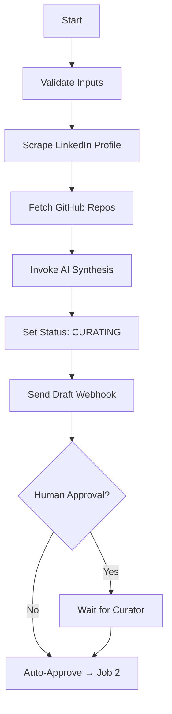
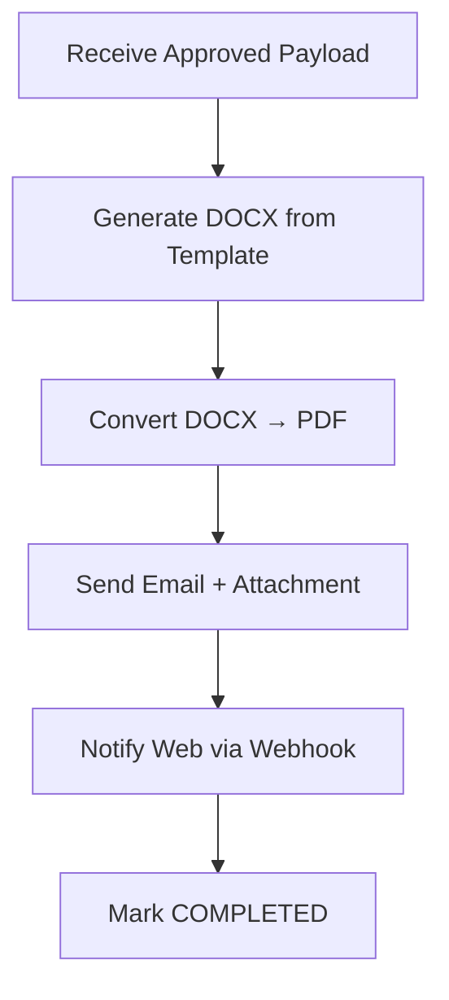

# Robot UiPath Workflow — AutoCV

Dokumentasi teknis modul robot UiPath untuk proses otomasi pembuatan CV.

---

## 🎯 Tujuan Robot

Robot UiPath bertugas:

1. **Job 1**: Mengambil data LinkedIn & GitHub, mengirim ke AI untuk sintesis
2. **Job 2**: Menghasilkan dokumen DOCX/PDF, mengirim email, notifikasi selesai

---

## 🧩 7 Modul Utama + Main.xaml

| No | Modul | Fungsi |
|----|-------|--------|
| 00 | `00_ValidateAndNormalizeInputs.xaml` | Validasi URL, normalisasi format input |
| 01 | `01_LinkedIn_ScrapeProfile.xaml` | Scraping profil LinkedIn via browser |
| 02 | `02_GitHub_FetchUserRepos.xaml` | Fetch repositori GitHub via API |
| 03 | `03_AI_SynthesizePortfolio.xaml` | Invoke AI (Gemini) untuk sintesis profil |
| 04 | `04_Document_GeneratePdf.xaml` | Render DOCX → PDF, generate output |
| 05 | `05_Notification_SendMail.xaml` | Kirim email dengan attachment |
| 06 | `06_Webhook_NotifyWeb.xaml` | Callback ke REST API Web |
| Main | `Main.xaml` | Entry point, kontrol Job 1 & Job 2 |

---

## 🔧 Argument & Naming Convention

### Convention Penamaan

- **Variabel**: `str_Name`, `bool_Flag`, `int_Count`, `dic_Data`
- **Argument Input**: `in_str_Name`, `in_bool_Flag`, `in_int_Count`
- **Argument Output**: `out_str_Name`, `out_bool_Flag`

### Argumen Utama Main.xaml

```json
{
  "in_JobId": "string (required for webhook)",
  "in_LinkedInUrl": "string",
  "in_GitHubUrl": "string", 
  "in_TargetJobRole": "string",
  "in_RecipientEmail": "string",
  "in_AuthorizedResumePayload": "string (optional, triggers Job 2)",
  "in_WebhookBaseUrl": "string",
  "in_UseMockFallback": "boolean",
  "in_RequireManualApproval": "boolean (default true)"
}
```

---

## 🔄 Job Flow

### Job 1 (Scraping & Synthesis)



### Job 2 (Document Generation)



---

## ⚙️ Prasyarat & Setup

### Prerequisites

| Komponen | Versi |
|----------|-------|
| Windows 10/11 64-bit | - |
| UiPath Studio | 26.10 |
| UiPath Orchestrator Cloud | dengan tenant custom |
| Chrome/Edge | dengan ekstensi UiPath Web Automation |
| Node.js | ≥ 20 (untuk script helper) |

### Tenant Orchestrator yang Diperlukan

- **Folder**: AutoCV-Folder (ID: ditemukan di Orchestrator)
- **Process Key Job 1**: `AutoCV-Scrape-and-Synthesize`
- **Process Key Job 2**: `AutoCV-Document-Delivery`
- **Assets**: `GEMINI_API_KEY`, `SMTP_PASSWORD` (Credential type)

---

## 🔐 Keamanan & Logging

### Penyimpanan Rahasia

- API key disimpan di **Orchestrator Assets** sebagai Credential
- Lokal: `.env` atau `Data/Config/ai_settings.json` (tidak di-commit)
- Access melalui `GetCredential` activity → SecureString

### Logging Robot

- **Lokasi Log Lokal**: `%LocalAppData%\UiPath\Logs`
- **Log Cloud**: Hanya accessible untuk user dengan permission di tenant
- **Data yang Tidak Dilog**: Password, token, profil lengkap, email penerima

### Log yang Dihindari

```visualbasic
# Tidak boleh ada log berikut:
LogMessage strLinkedInDataJson   # data profil lengkap
LogMessage in_GitHubToken          # token akses
LogMessage strNormalizedEmail      # email kandidat
```

---

## 🧪 Testing & Hasil

### Mode Mock

Untuk testing tanpa kredensial eksternal:

```json
{
  "in_UseMockFallback": true,
  "in_LinkedInUrl": "Data/Mocks/LinkedInMock.json",
  "in_GitHubUrl": "Data/Mocks/mock_github_repos.json"
}
```

### Hasil Demo (Orchestrator)

```
Job 1: SCRAPING → SYNTHESIZING → CURATING  [Status: CURATING]
Job 2: APPROVED → DOCUMENT_GENERATION → DELIVERY  [Status: COMPLETED]

3/3 jobs Successful
```

---

## 📧 Referensi

- [UiPath Documentation](https://docs.uipath.com/)
- [Gemini API Docs](https://ai.google.dev/)
- [OpenRouter API Docs](https://openrouter.ai/)